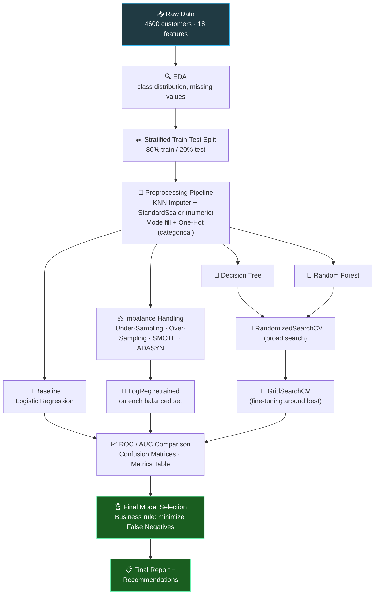

<!-- ===================== HEADER GIF / BANNER ===================== -->
<p align="center">
  
</p>

<p align="center">
  
</p>

<p align="center">
  
</p>

<!-- ===================== BADGE BUTTONS ===================== -->
<p align="center">
  
  
  
  
  
</p>

<p align="center">
  
  
  
  
  
  
</p>

<!-- ===================== BIG ACTION BUTTONS ===================== -->
<p align="center">
  <a href="https://youtu.be/YOUR_VIDEO_ID">
    
  </a>
  &nbsp;
  <a href="https://colab.research.google.com/github/jeelprajapati0606/Risk_Alert_Classifier/blob/main/Risk%20Classifier/Risk_Alert_Classifier-checkpoint.ipynb">
    
  </a>
  &nbsp;
  <a href="https://nbviewer.org/github/jeelprajapati0606/Risk_Alert_Classifier/blob/main/Risk%20Classifier/Risk_Alert_Classifier-checkpoint.ipynb">
    
  </a>
  &nbsp;
  <a href="https://github.com/jeelprajapati0606/Risk_Alert_Classifier/blob/main/Risk%20Classifier/Risk_Alert_Theory_and_Final_Report.pdf">
    
  </a>
</p>


## 🧠 What Is This Project? (In Simple Words)

> 🏦 Imagine you work at a **digital bank**. Every day thousands of customers swipe, borrow, and pay back money.
> **Most customers are safe** ✅ — but a small hidden group is **risky** 🚨: they may **default on payments** or even commit **fraud**.
>
> Catching them *after* the damage is too late. So the bank wants an **early-warning system** — like a **smoke detector** 🚒 — that sniffs out risky customers **before** the fire starts.

This project builds exactly that: a **Machine Learning classification system** that looks at a customer's profile + behavior and predicts:

| Target Value | Meaning |
|:---:|:---|
| **0** | 🟢 **Low Risk** – customer is safe, business as usual |
| **1** | 🔴 **High Risk** – customer is likely to default / behave fraudulently → **flag them early!** |

**The catch?** Only **~12%** of customers are high risk. The data is **imbalanced** — and a lazy model can get 88% accuracy by saying "everyone is safe"… while catching **zero** risky customers. 😱 This project shows how to detect that trap and fix it.


## 📊 Dataset Snapshot

| Item | Detail |
|:---|:---|
| 📦 Rows (customers) | **4,600** |
| 🧩 Columns | **19** (18 features + 1 target) |
| 🎯 Target | `risk_status` → `0 = Low Risk`, `1 = High Risk` |
| ⚖️ Class balance | **87.9% Low** vs **12.1% High** → *imbalanced!* |
| 🕳️ Missing values | `credit_score` (216), `annual_income_inr` (166), `credit_utilization_ratio` (147), `employment_type` (144), `age` (140), `monthly_spend_inr` (129), `region` (102) |

**Feature groups:**

| 🧍 Demographic | 💳 Credit Behavior | 🔄 Transactions & Activity |
|:---|:---|:---|
| `age`, `gender`, `region`, `employment_type`, `annual_income_inr` | `credit_score`, `credit_utilization_ratio`, `missed_payments_12m`, `avg_late_payment_days`, `debt_balance_inr` | `monthly_transaction_count`, `monthly_spend_inr`, `cash_advance_count_6m`, `complaints_last_6m`, `failed_login_attempts_3m`, `account_tenure_months`, `last_transaction_date` |


## 🔄 Project Pipeline (Workflow)



**📌 In one line:**

```
Load Data → Clean & Impute → Stratified Split → Baseline Model → Balance Data →
Tree Models → Tune Hyperparameters → Compare ROC/AUC → Pick Model that Misses the Fewest Risky Customers
```


## 📁 Repository Structure

```
Risk_Alert_Classifier/
│
├── README.md                                   ← You are here 👋
└── Risk Classifier/
    ├── Risk_Alert_Classifier-checkpoint.ipynb  ← 📓 Full notebook (Parts A–H with interpretations)
    ├── Risk_Alert_Classifier_Data.csv          ← 📊 Dataset (4,600 customers)
    ├── Risk_Alert_Theory_and_Final_Report.pdf  ← 📄 Theory answers + final report
    ├── model_comparison_results.csv            ← 📈 All model metrics in one table
    └── stress_test_results.csv                 ← 🧪 Imbalance stress-test results
```


## 🚀 Getting Started

**1️⃣ Clone the repo**

```bash
git clone https://github.com/jeelprajapati0606/Risk_Alert_Classifier.git
cd "Risk_Alert_Classifier/Risk Classifier"
```

**2️⃣ Install dependencies**

```bash
pip install pandas numpy scikit-learn imbalanced-learn matplotlib seaborn jupyter
```

**3️⃣ Run the notebook**

```bash
jupyter notebook Risk_Alert_Classifier-checkpoint.ipynb
```

> ☁️ **No installation?** Just hit the **"Open in Colab"** button at the top of this page!


## 🧑‍💻 Main Code Explained (Plain English)

### 1️⃣ Stratified Split — *keeping the ratio fair* ⚖️

```python
X_train, X_test, y_train, y_train_dummy = None, None, None, None  # (simplified view)
X_train, X_test, y_train, y_test = train_test_split(
    X, y, test_size=0.20, stratify=y, random_state=42)
```

> **What it does:** Splits data 80/20 into training and testing sets.
> **Why `stratify=y` matters:** It guarantees both sets keep the **same ~12% share of high-risk customers**. Without it, the test set could randomly contain almost no risky customers — making evaluation meaningless.

---

### 2️⃣ Preprocessing Pipeline — *cleaning + filling smartly* 🧼

```python
num_pipe = Pipeline([("scale", StandardScaler()),
                     ("knn_imputer", KNNImputer(n_neighbors=5))])

cat_pipe = Pipeline([("fill", SimpleImputer(strategy="most_frequent")),
                     ("onehot", OneHotEncoder(handle_unknown="ignore", sparse_output=False))])

preprocess = ColumnTransformer([("num", num_pipe, num_cols),
                                ("cat", cat_pipe, cat_cols)])
```

> **What it does:**
> - 🔢 **Numeric columns** → scaled to a common range, then missing values filled by **KNN Imputer** (looks at the 5 most similar customers and guesses the missing value — much smarter than filling with the average).
> - 🔤 **Categorical columns** → missing filled with the most common value, then converted to numbers via One-Hot Encoding.
>
> **Why a Pipeline?** Everything is fit **only on training data** and then applied to test data — this prevents **data leakage** (accidentally peeking at test data).

---

### 3️⃣ The `evaluate()` Helper — *one function to judge them all* 📏

```python
def evaluate(name, model, X_te=None, y_te=None):
    """Evaluate a fitted model on the test set and store the metrics."""
    pred  = model.predict(X_te)
    proba = model.predict_proba(X_te)[:, 1]
    tn, fp, fn, tp = confusion_matrix(y_te, pred).ravel()
    results[name] = {
        "Accuracy": accuracy_score(y_te, pred),
        "Precision": precision_score(y_te, pred, zero_division=0),
        "Recall (High Risk)": recall_score(y_te, pred),
        "F1-Score": f1_score(y_te, pred),
        "AUC-ROC": roc_auc_score(y_te, proba),
        "TN": tn, "FP (Type-I)": fp, "FN (Type-II)": fn, "TP": tp}
```

> **What it does:** Every model in the project is scored through this **single reusable function**, so all models are judged by **exactly the same ruler** — accuracy, precision, recall, F1, AUC-ROC **and** the raw confusion-matrix counts (TP / FP / FN / TN). No cherry-picking. ✅

---

### 4️⃣ Balancing the Data — *4 weapons against imbalance* ⚔️

```python
samplers = {
    "Under-Sampling": RandomUnderSampler(random_state=42),   # drop extra safe customers
    "Over-Sampling":  RandomOverSampler(random_state=42),    # duplicate risky ones
    "SMOTE":          SMOTE(random_state=42),                # invent NEW synthetic risky ones
    "ADASYN":         ADASYN(random_state=42),               # SMOTE, but harder cases get more copies
}

for name, sampler in samplers.items():
    X_res, y_res = sampler.fit_resample(X_train_p, y_train)
```

> **What it does:** Retrains Logistic Regression on 4 differently balanced training sets.
> **⚠️ Golden rule followed:** Sampling is applied **only to the training data** — the test set stays untouched and realistic, just like the real world.

---

### 5️⃣ Two-Stage Tuning — *wide net first, then zoom in* 🎣

```python
# Stage 1: Randomized Search — try 25 random combos across a WIDE range
dt_search = RandomizedSearchCV(DecisionTreeClassifier(random_state=42), dt_params,
                               n_iter=25, scoring="f1",
                               cv=StratifiedKFold(5, shuffle=True, random_state=42),
                               random_state=42, n_jobs=-1)

# Stage 2: Grid Search — check a SMALL neighbourhood around the winner
grid = {"n_estimators": around(best["n_estimators"], 100, low=50),
        "max_depth":    around(best["max_depth"], 3) ... }

rf_grid = GridSearchCV(RandomForestClassifier(random_state=42, n_jobs=-1), grid,
                       scoring="f1", cv=StratifiedKFold(3, shuffle=True, random_state=42))
```

> **What it does:** `RandomizedSearchCV` first explores a **big** parameter space cheaply, then `GridSearchCV` **fine-tunes** around the best spot. This combo gets ~(near)optimal settings **without** the huge cost of a full grid search. Tuning is scored on **F1**, not accuracy — because accuracy lies on imbalanced data. 😉

---

### 6️⃣ ROC Curves — *the beauty contest for classifiers* 📈

```python
for name, (fpr, tpr, auc) in sorted(roc_store.items(), key=lambda kv: -kv[1][2]):
    plt.plot(fpr, tpr, lw=2, label=f"{name} (AUC = {auc:.3f})")
plt.plot([0, 1], [0, 1], "k--", label="Random guess (AUC = 0.5)")
```

> **What it does:** Plots every model's **ROC curve** on one chart. Curves hugging the **top-left corner** catch more risky customers while making fewer false alarms. The dashed diagonal = a model that just guesses randomly — any model must beat it to be useful.

---

### 7️⃣ Final Model Selection — *a business rule, not just a number* 🏆

```python
# Rule: 1) AUC within 0.03 of the best  →  2) highest Recall (fewest missed risky customers)
#        → 3) tie-break by F1  →  4) prefer the SIMPLER, explainable model
final_model = model_lookup[best_name]
print("Selected model:", best_name)   # → Logistic Regression (baseline)
```

> **Result:** `Logistic Regression (baseline)` won — it achieved **Recall = 1.0 (zero missed high-risk customers)** with perfect AUC, and as the **simplest + most explainable** model, it beats fancier models that score the same. In banking, *explainability to regulators* is a superpower. 🦸


## 📈 Results — All Models, One Table

> Evaluated on the untouched test set (920 customers, 111 truly high-risk):

| Model | Accuracy | Precision | **Recall (High Risk)** | F1 | AUC-ROC | 🔴 FN (missed) | 🟡 FP (false alarm) |
|:---|:---:|:---:|:---:|:---:|:---:|:---:|:---:|
| **Logistic Regression (baseline) 🏆** | **1.0000** | **1.0000** | **1.0000** | **1.0000** | **1.0000** | **0** | 0 |
| LogReg + Under-Sampling | 0.9978 | 0.9823 | 1.0000 | 0.9911 | 1.0000 | 0 | 2 |
| LogReg + Over-Sampling | 0.9978 | 0.9823 | 1.0000 | 0.9911 | 1.0000 | 0 | 2 |
| LogReg + SMOTE | 0.9978 | 0.9823 | 1.0000 | 0.9911 | 1.0000 | 0 | 2 |
| LogReg + ADASYN | 0.9978 | 0.9823 | 1.0000 | 0.9911 | 1.0000 | 0 | 2 |
| Random Forest | 0.9989 | 1.0000 | 0.9910 | 0.9955 | 1.0000 | 1 | 0 |
| Random Forest (random search) | 0.9978 | 0.9910 | 0.9910 | 0.9910 | 1.0000 | 1 | 1 |
| Random Forest (tuned – grid) | **0.9989** | 0.9911 | **1.0000** | 0.9955 | 1.0000 | **0** | 1 |
| Random Forest (tuned) + SMOTE | 0.9978 | 0.9910 | 0.9910 | 0.9910 | 0.9999 | 1 | 1 |
| Decision Tree (tuned) | 0.9815 | 0.9123 | 0.9369 | 0.9244 | 0.9797 | 7 | 10 |
| Decision Tree (untuned) | 0.9696 | 0.8952 | 0.8468 | 0.8704 | 0.9166 | 17 | 11 |

**🔍 Key takeaways:**
- 🌳 **Untuned Decision Tree** = classic overfitter → nearly memorizes training data but misses **17** risky customers in the real world. Tuning alone cuts misses from **17 → 7**.
- 🌲 **Random Forest** beats the single tree on generalization (many trees + voting = stability).
- 🏆 **Tuned Random Forest** also hits **0 missed risky customers**, but Logistic Regression matches it while being simpler → **final pick**.

### 🧪 Stress Test: What Imbalance *Really* Does

To prove imbalance handling works, the models were re-tested on a **harder version** of the problem (only 4 weak features):

| Technique | Accuracy | Precision | **Recall (High Risk)** | F1 | AUC |
|:---|:---:|:---:|:---:|:---:|:---:|
| ❌ No balancing | 0.9587 | 0.8842 | **0.7568** 😱 | 0.8155 | 0.9732 |
| ➖ Under-Sampling | 0.8750 | 0.4907 | **0.9550** 🔥 | 0.6483 | 0.9718 |
| ➕ Over-Sampling | 0.8826 | 0.5072 | **0.9550** 🔥 | 0.6625 | 0.9725 |
| ✨ SMOTE | 0.8880 | 0.5198 | **0.9459** 🔥 | 0.6709 | 0.9731 |
| 🌀 ADASYN | 0.8261 | 0.4068 | **0.9640** 🔥 | 0.5722 | 0.9730 |

> **Lesson:** Without balancing, the model misses **1 in 4** risky customers — while still looking "great" at 95.9% accuracy! Balancing trades a bit of precision for a **big recall jump (0.76 → 0.96)**. For a bank, that's the right trade. 💰


## 💼 Business Interpretation — What FP & FN Cost the Bank

| Error | Meaning | Real-World Cost |
|:---|:---|:---|
| 🟡 **False Positive (Type-I)** | A **safe** customer gets flagged as risky | Cheap: a manual review / a phone call 📞. Too many = annoyed customers + wasted analyst time. |
| 🔴 **False Negative (Type-II)** | A **risky** customer slips through | **Expensive**: unpaid loans, chargebacks, fraud losses 💸 |

> 🎯 **Business decision:** The bank would rather review a few extra false alarms than miss even one defaulter — so the final model is chosen to **minimize False Negatives** (maximize Recall) while keeping AUC-ROC near-perfect.

## ✅ Conclusions & Recommendations

1. 🚨 **Accuracy is a trap** on imbalanced data — a "predict everyone is safe" model scores ~88% yet catches nobody. Always report **Recall, Precision, F1 and AUC-ROC**.
2. 🧽 **KNN Imputation + stratified splitting** gave clean, leakage-free training data.
3. ⚖️ **Balancing techniques matter most when the signal is weak** — SMOTE/ADASYN lifted recall from 0.76 → 0.96 in the stress test.
4. 🌲→🔧 **Hyperparameter tuning rescued the Decision Tree** (17 missed → 7 missed high-risk customers) and pushed Random Forest to near-perfection.
5. 🏆 **Simplest model that meets the business rule wins**: Logistic Regression — 100% recall, fully explainable to auditors and regulators.
6. 🔮 **Next steps:** try XGBoost/LightGBM, probability calibration, threshold tuning, and a monitoring dashboard for model drift.


## 📚 Project Contents Mapping

| Assignment Part | Where to Find It |
|:---|:---|
| **Part A** – Theory (LogReg, metrics, Type-I/II errors, AUC-ROC, imbalance) | 📄 `Risk_Alert_Theory_and_Final_Report.pdf` + notebook markdown |
| **Part B** – Dataset prep, stratified split, KNN Imputer | 📓 Notebook → Part B |
| **Part C** – Baseline Logistic Regression + confusion matrix | 📓 Notebook → Part C |
| **Part D** – Under/Over-Sampling, SMOTE, ADASYN + stress test | 📓 Notebook → Part D |
| **Part E** – Decision Tree vs Random Forest, overfitting analysis | 📓 Notebook → Part E |
| **Part F** – RandomizedSearchCV + GridSearchCV tuning | 📓 Notebook → Part F |
| **Part G** – ROC curves, AUC comparison, final model selection | 📓 Notebook → Part G |
| **Part H** – Final report, FP/FN business interpretation | 📓 Notebook → Part H + PDF |


## 👨‍💻 Author

<p align="center">
   <b>Jeel Prajapati</b>
</p>

<p align="center">
  <a href="https://github.com/jeelprajapati0606">
    
  </a>
  &nbsp;
  <a href="mailto:jeelprajapati0606@gmail.com">
    
  </a>
</p>

---

<p align="center">
  ⭐ <b>If this project helped you, drop a star — it keeps the motivation engine running!</b> ⭐<br><br>
  <a href="https://github.com/jeelprajapati0606/Risk_Alert_Classifier/stargazers">
    
  </a>
</p>

<!-- ===================== FOOTER GIF / BANNER ===================== -->
<p align="center">
  
</p>
